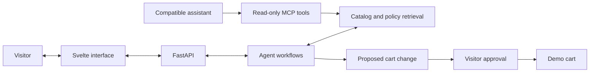

# Yehor Trepalin's portfolio

*Welcome. Take a look around.*

[Visit the website](https://yehor-trepalin.up.railway.app/) · [LinkedIn](https://www.linkedin.com/in/yehor-trepalin/) · [GitHub](https://github.com/yo1am1) · [The engineering](#the-engineering)

I'm Yehor Trepalin. This is my résumé as a website where you can explore my work and ask questions about it. A small cast of agents helps you find your way, and a Tea shop demo gives you something to try.

I've put a lot of work into this project, from the Python services behind a conversation to the way a paper corner moves. I wanted the place to feel handmade: textured fabric, uneven paper edges and notes written in the margins. The same care goes into what happens after you press Send.

> The paper interface and résumé workspace are live. The Tea shop is a fictional demonstration: its products, prices, policies, carts and tickets are synthetic, with no real orders or payments.

## Meet the agents

You can start with Main or go straight to a specialist. Each has its own colour and workspace.

| Space | What you can explore | A place to start |
| --- | --- | --- |
| Main | A coordinator that plans longer requests, brings in specialists and keeps their answers together. | "Ask Tea to show me black teas under 8 EUR." |
| Portfolio | My published résumé beside a conversation about documented experience, skills and projects. | "Which projects put the documented skills into practice?" |
| Tea | A demo shop with product search, comparisons, brewing advice and a cart you control. | "Find a caffeine-free tea with citrus notes." |

Projects is planned for a later version. For now, Portfolio also answers questions about the projects documented in my résumé.

### Main brings the right person into the conversation

For longer requests, Main can show a todo list so you can follow the work. A question that needs Tea or Portfolio brings the specialist's response into the same conversation as a letter with its own name and colour.

*A live production conversation: Main's completed plan and Tea's own letter with catalog cards. The named reply comes through the app's private Agent-to-Agent (A2A) exchange.*

### The résumé stays beside the question

In [Portfolio](https://yehor-trepalin.up.railway.app/portfolio), you can read my résumé and ask about the part that interests you. “Ask about this” drafts a question about a role, project or skill. Answers point back to the résumé lines they use, and “Show in résumé” takes you to the source.

The PDF is available from the same workspace. You can ask for the documented background, compare the skills shown across projects or check what the résumé leaves unanswered.

### Tea turns a question into something you can inspect

The Tea shop gives the assistant a concrete job. A request about taste, price or caffeine leads to catalog lookups and product cards. You can inspect the details, ask a follow-up, compare options or get brewing guidance.

The cart is a separate decision. A proposed change waits for approval before it happens. All catalog entries, prices and shop policies are synthetic; there are no real orders, payments or deliveries.

*The human-in-the-loop step: you review the item and quantity before approving. Rejecting leaves the cart unchanged.*

A few more questions to try:

- "Compare two green teas under 10 EUR."
- "How should I brew an oolong?"
- "Show me black teas under 8 EUR."

### A support question becomes a ticket you can review

Tea can open an editable support form from a conversation. Review the reason and summary, change the text if needed, then submit it. The saved demo ticket stays with the conversation and is still there after a reload.

These tickets stay inside the demonstration; no message is sent to a real support team.

## Why paper?

Coraline (2009) is the visual reference. I like its handmade textures and the feeling that ordinary objects have a life of their own. That led to the fabric backgrounds, stitched edges and little paper scraps on the welcome page.

The folded corner catches a small gust when it rests. Hovering lifts it further; turning the page plays a few held drawings, then lets the next workspace fade into view. The lettering moves in held poses too. Each agent keeps the same paper language while changing the colour around it.

Getting those details right has taken iteration. Notes need room around their arrows. A corner should stay pinned while the paper moves. Scrolling a conversation should let you read its history without accidentally leaving the chat. Keyboard access and reduced-motion settings have to fit that design as well.

See the interface on a smaller screen

  

The welcome card scrolls inside its own area on a small screen. The conversation keeps its composer within reach, and the side panels become drawers.

## The engineering

My work on the project spans the interface, Python backend, retrieval and the connections between agents and tools. The challenge is keeping those pieces consistent when a request crosses several boundaries or a dependency is unavailable.

| Part | Technology | What it does here |
| --- | --- | --- |
| Interface | Svelte, TypeScript, Vite | Conversation state, product cards, agent workspaces and the paper interactions. |
| API | Python, FastAPI | Visitor-owned sessions, streamed events, approvals and completed turn records. |
| Agent workflows | LangGraph | Tool use, conversation state and interruptions for approval. |
| Retrieval | Neo4j, embeddings and reranking | Catalog and policy search using meaning, text matches and graph relationships. |
| Persistence | SQLite | Conversation records, demo carts and application state. |
| External tools | Model Context Protocol (MCP) | Read-only catalog and policy lookups for compatible assistants. |
| Agent exchange | Agent-to-Agent (A2A) | Private specialist requests and replies with their original author attached. |

Several choices shape the behaviour:

- Facts come from catalog and policy tools. Structured results become the cards you see, and replies pass through checks before reaching the chat.
- A model can propose a cart change; the visitor decides whether to approve it. The read-only MCP interface exposes lookups without granting cart or conversation control.
- Specialist work shares limits and a deadline. Delegation has a stopping point, and a returned letter retains the specialist's identity.
- Progress and completed answers have different roles. The interface can show work underway while the backend records the accepted final response.
- Readiness and cancellation are part of the conversation flow. The application handles dependencies waking after inactivity and gives queued work a finite wait.

### Tools for another assistant

The same tea catalog is available through [Tea Catalog MCP](https://yehor-trepalin.up.railway.app/mcp-guide/). Connect a compatible client, such as VS Code, to search products, compare teas, read brewing instructions or look up a shop policy. These tools are read-only; they cannot change a visitor's cart, conversations or tickets.

See the MCP connection guide

The guide includes the server address and a copyable client configuration. The connected assistant writes the answer; this server supplies read-only tools and prompts.

The site's own specialists use a separate, private A2A connection. Their replies keep the original sender attached. [How the agents talk to each other](https://yehor-trepalin.up.railway.app/a2a-guide/) explains that journey; it is not a public agent endpoint.

A view of the system

This is an overview of the responsibilities. It leaves the private implementation and deployment configuration out of the diagram.

### What I've checked

The project has Python tests for backend behaviour, frontend tests for state and components, and type and build checks. Browser checks cover the paper interactions, keyboard navigation, small viewports and reduced motion.

The conversation screenshots were captured from live production responses in October 2026. The welcome, mobile welcome and MCP setup images come from the matching staging interface. No conversation responses were mocked for these images.

For this update, I checked that a cart stays unchanged before approval, that approval applies the proposed change and that rejection leaves it alone. A submitted support ticket survived reload. The public MCP endpoint completed initialization, exposed its seven tools and answered a read-only category lookup.

These checks cover the shown flows. Model accuracy, sustained-load capacity and business results need separate evidence.

## Source and contact

The full application repository stays private. This public showcase contains the project story and selected images; it will grow with the website.

If you'd like to discuss my work or a role, reach me at [bigdiebam@gmail.com](mailto:bigdiebam@gmail.com) or on [LinkedIn](https://www.linkedin.com/in/yehor-trepalin/). My other public projects are on [GitHub](https://github.com/yo1am1).
