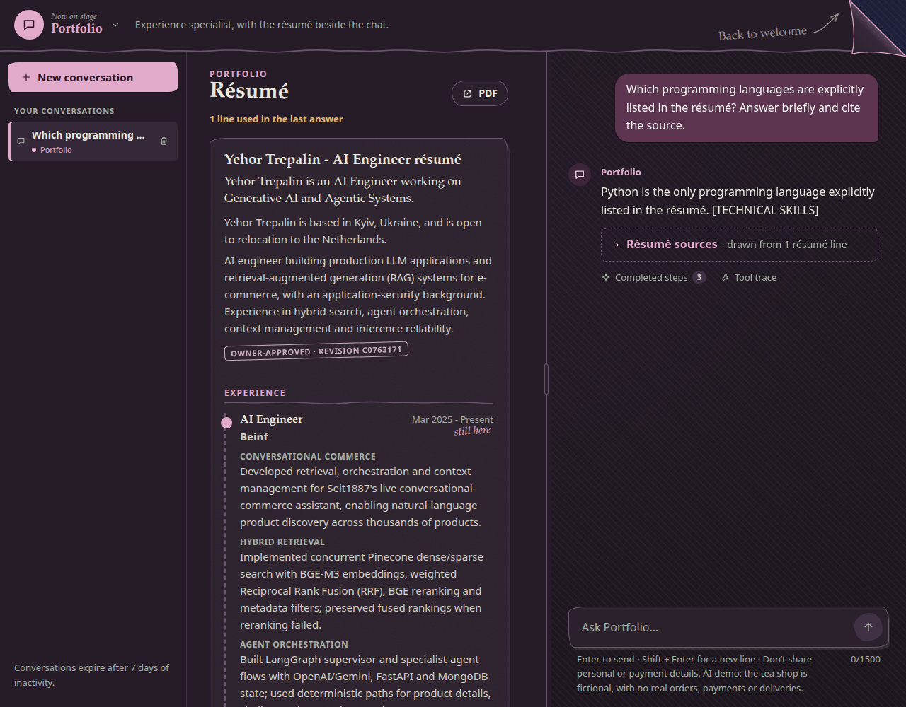
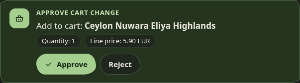
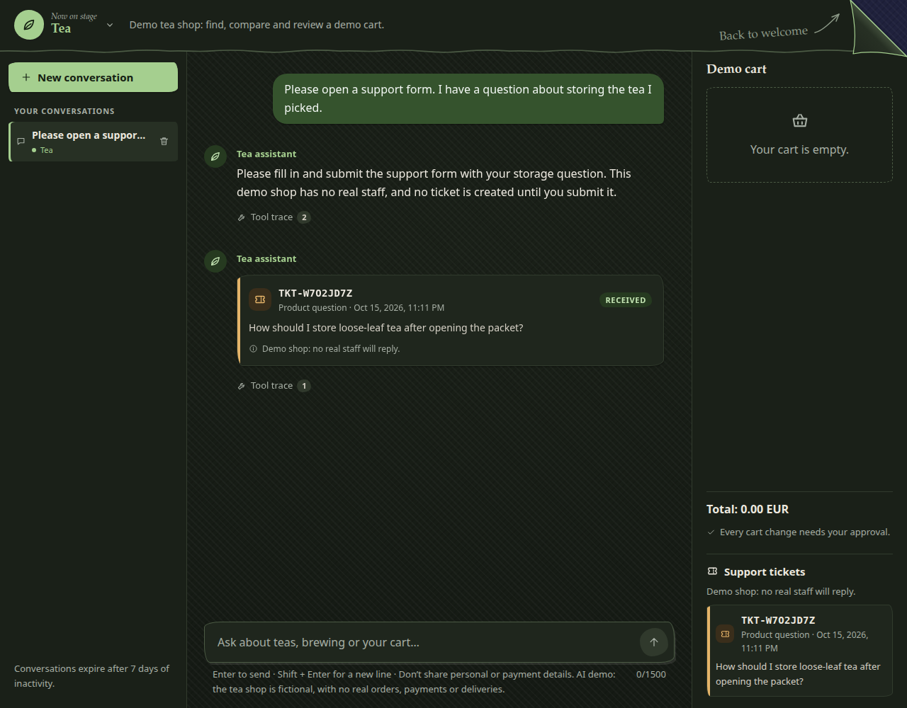
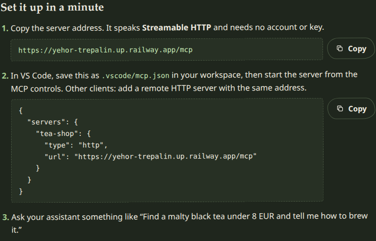
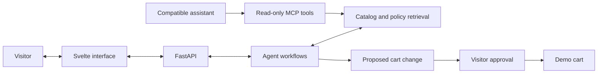

# Yehor Trepalin's portfolio

*Welcome. Take a look around.*

[Visit the website](https://yehor-trepalin.up.railway.app/) · [LinkedIn](https://www.linkedin.com/in/yehor-trepalin/) · [GitHub](https://github.com/yo1am1) · [The engineering](#the-engineering)

I'm Yehor Trepalin. I built this site around my résumé so you can read about my work and ask questions about it. A small cast of agents helps you find your way, and a Tea shop demo gives you something to try.

I worked on the Python services behind the conversations and the paper interactions in the interface. I wanted the place to feel handmade, with textured fabric, uneven paper edges and notes written in the margins.

> My résumé and the paper interface are live. The Tea shop is a fictional demonstration: its products, prices, policies, carts and tickets are synthetic, with no real orders, payments or deliveries.

## Meet the agents

I gave Main, Portfolio and Tea their own colours and workspaces. You can start with Main or go straight to a specialist.

| Space | What you can explore | A place to start |
| --- | --- | --- |
| Main | A coordinator that plans longer requests, brings in specialists and keeps their answers together. | "Ask Tea to show me black teas under 8 EUR." |
| Portfolio | My published résumé beside a conversation about documented experience, skills and projects. | "Which projects put the documented skills into practice?" |
| Tea | A demo shop with product search, comparisons, brewing advice and a cart you control. | "Find a caffeine-free tea with citrus notes." |

I plan to add a separate Projects workspace. For now, Portfolio answers questions about the projects in my résumé.

### A plan and a reply from a specialist

For requests that need a few steps, I use Main to coordinate the work. It can write a todo list and bring in Tea or Portfolio. I show the specialist's reply as a letter with its own name and colour, so you can see who answered without leaving the conversation.

*Tea answers through the private Agent-to-Agent (A2A) exchange and returns its own letter with catalog cards.*

### My résumé stays beside the chat

I keep my résumé beside the conversation in [Portfolio](https://yehor-trepalin.up.railway.app/portfolio), so you can read it while asking about the part that interests you. “Ask about this” drafts a question about a role, project or skill. I link answers back to the résumé lines they use; “Show in résumé” takes you to the source.

The PDF is in the same workspace. You can ask about my background, compare the skills shown across projects or check what the résumé leaves unanswered.

### Try the Tea shop

I built the Tea shop around catalog and policy lookups. You can ask about taste, price or caffeine, then inspect the product cards, ask a follow-up, compare options or get brewing advice.

I put a human-in-the-loop approval step before cart changes. Tea can propose a change; you review the item and quantity and decide whether to apply it.

*Rejecting a change leaves the cart as it was.*

A few more questions to try:

- "Compare two green teas under 10 EUR."
- "How should I brew an oolong?"
- "Show me black teas under 8 EUR."

### Open a support ticket

For support questions, I added an editable form to Tea. You can open it from a conversation, review the reason and summary, change the text and submit it. The saved ticket stays with that conversation after a reload.

These tickets stay inside my demo and don't go to a real support team.

## Why paper?

Coraline (2009) was my visual reference. I like its handmade textures and the feeling that ordinary objects have a life of their own. That led to the fabric backgrounds, stitched edges and little paper scraps on the welcome page.

The folded corner catches a small gust when it rests. Hovering lifts it further; turning the page plays a few held drawings, then lets the next workspace fade into view. The lettering moves in held poses too. I kept the paper treatment across the agents and changed the colours for each one.

I've spent time adjusting the small details. Notes need room around their arrows, and a corner should stay pinned while the paper moves. I wanted readers to be able to scroll back through a conversation without accidentally leaving it. I also checked keyboard access and reduced motion as part of that work.

See the interface on a smaller screen

  

The welcome card scrolls inside its own area on a small screen. The conversation keeps its composer within reach, and the side panels become drawers.

## The engineering

I built the interface and Python backend, connected the agents to their tools and worked on retrieval. I had to account for requests crossing those boundaries and for dependencies being unavailable.

| Part | Technology | What it does here |
| --- | --- | --- |
| Interface | Svelte, TypeScript, Vite | Conversation state, product cards, agent workspaces and the paper interactions. |
| API | Python, FastAPI | Visitor-owned sessions, streamed events, approvals and completed turn records. |
| Agent workflows | LangGraph | Tool use, conversation state and interruptions for approval. |
| Retrieval | Neo4j, embeddings and reranking | Catalog and policy search using meaning, text matches and graph relationships. |
| Persistence | SQLite | Conversation records, demo carts and application state. |
| External tools | Model Context Protocol (MCP) | Read-only catalog and policy lookups for compatible assistants. |
| Agent exchange | Agent-to-Agent (A2A) | Private specialist requests and replies with their original author attached. |

- Catalog and policy facts come from tools. I turn their structured results into cards, and the app checks replies before showing them.
- I require the visitor's approval for cart changes. MCP clients get read-only lookups, with no cart or conversation controls.
- Specialist calls share limits and a deadline. I keep the specialist's identity on each returned letter.
- Progress can appear while work is underway. I keep it separate from the final response recorded by the backend.
- I added readiness handling for dependencies waking after inactivity. Requests can be cancelled, and queued work has a finite wait.

### Tools for another assistant

I've also made the tea catalog available through [Tea Catalog MCP](https://yehor-trepalin.up.railway.app/mcp-guide/). You can connect a compatible client, such as VS Code, to search products, compare teas, read brewing instructions or look up a shop policy. I keep these tools read-only; they can't change a visitor's cart, conversations or tickets.

See the MCP connection guide

Your assistant writes the answer using the tools and prompts I provide through MCP. The guide has the server address and a copyable client configuration.

I keep the site's A2A exchange private, with the original sender attached to each specialist reply. [How the agents talk to each other](https://yehor-trepalin.up.railway.app/a2a-guide/) explains how those requests and replies travel through the app.

A view of the system

## Source and contact

The application source is private. In this repository, I share the project story and selected screenshots.

If you'd like to discuss my work or a role, reach me at [bigdiebam@gmail.com](mailto:bigdiebam@gmail.com) or on [LinkedIn](https://www.linkedin.com/in/yehor-trepalin/). My other public projects are on [GitHub](https://github.com/yo1am1).
