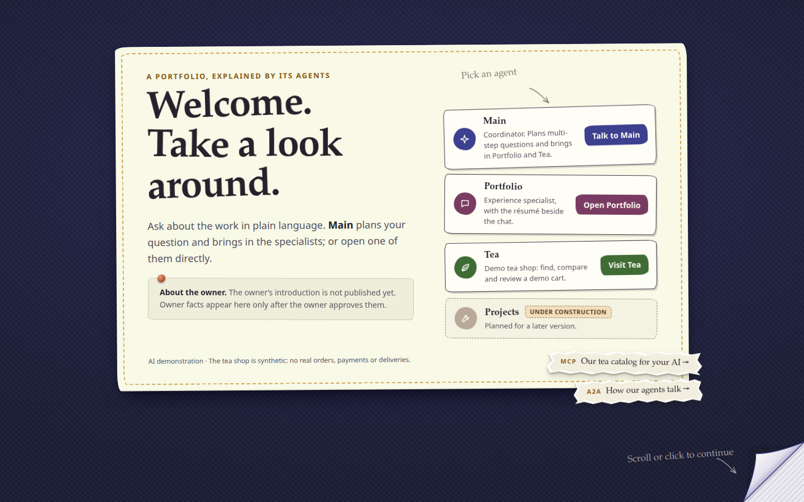
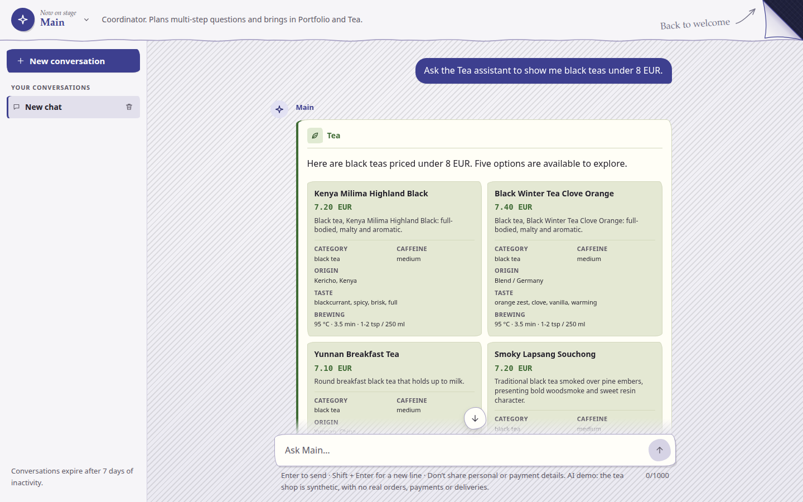
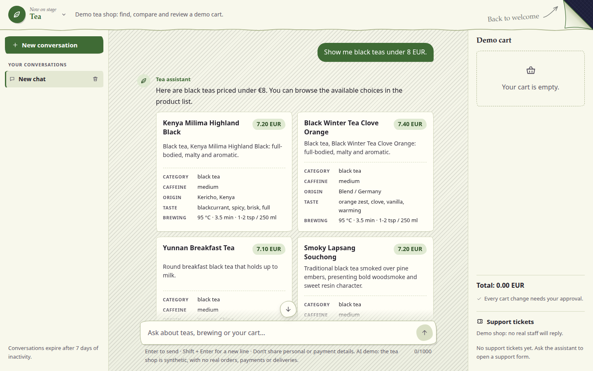
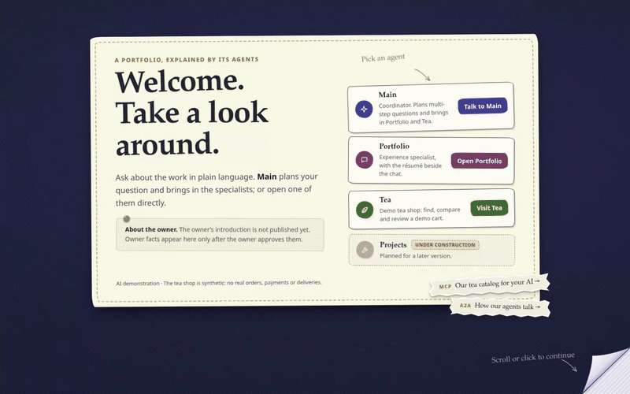
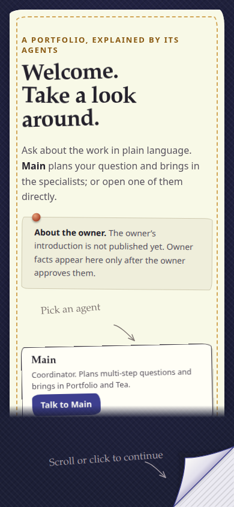
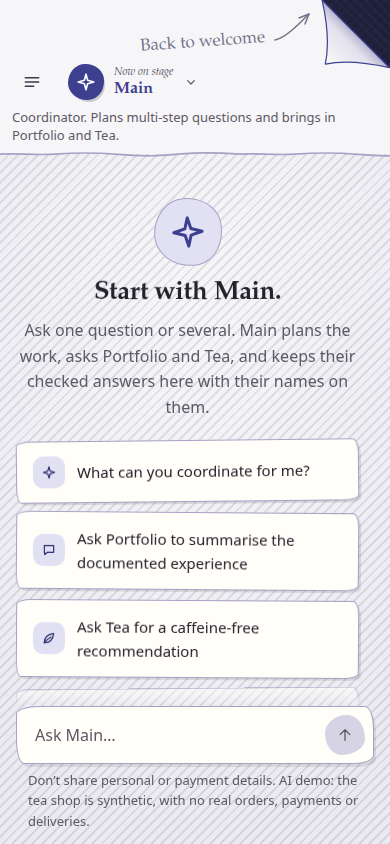
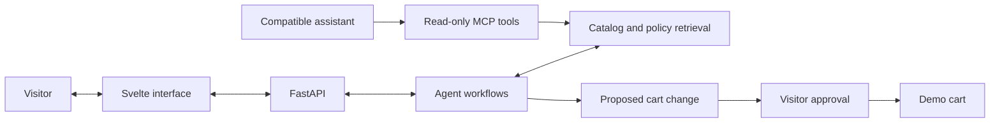

# Yehor Trepalin's portfolio

*Welcome. Take a look around.*

[Visit the website](https://yehor-trepalin.up.railway.app/) · [LinkedIn](https://www.linkedin.com/in/yehor-trepalin/) · [GitHub](https://github.com/yo1am1) · [The engineering](#the-engineering)

I'm Yehor Trepalin. I'm turning my résumé into a website where you can explore my work and ask questions about it. A small cast of agents helps you find your way, and a Tea shop demo gives you something to try.

I've put a lot of work into this project, from the Python services behind a conversation to the way a paper corner moves. I wanted the place to feel handmade: textured fabric, uneven paper edges and notes written in the margins. The same care goes into what happens after you press Send.

> These screenshots show the current staging edition, captured in October 2026. The public website still opens the earlier Tea shop demo. The paper interface and résumé workspace are being prepared for the next release; my approved résumé and owner introduction are not published yet.

## Meet the agents

You can start with Main or go straight to a specialist. Each has its own colour and workspace.

| Space | What you can explore | A place to start |
| --- | --- | --- |
| Main | A coordinator that brings in specialists and keeps their answers together. | "Ask Tea to show me black teas under 8 EUR." |
| Portfolio | A résumé beside a conversation about experience and skills. The document is awaiting publication; current sample answers are synthetic. | Open the workspace to see the layout. |
| Tea | A demo shop with product search, comparisons, brewing advice and a cart you control. | "Find a caffeine-free tea with citrus notes." |

Projects is planned for a later version. The résumé will live on the website, so there will be one place to find its current version.

### Main brings the right person into the conversation

Ask Main a question that needs Tea, and the specialist's response arrives as a letter with Tea's name on it. You can see who answered while staying in the same conversation.

*An actual staging answer to a synthetic test question. The Tea letter and product cards were rendered from the accepted response, without a mocked API.*

### Tea turns a question into something you can inspect

The Tea shop gives the assistant a concrete job. A request about taste, price or caffeine leads to catalog lookups and product cards. You can inspect the details, ask a follow-up, compare options or get brewing guidance.

The cart is a separate decision. A proposed change waits for approval before it happens. All catalog entries, prices and shop policies are synthetic; there are no real orders, payments or deliveries.

A few more questions to try:

- "Compare two green teas under 10 EUR."
- "How should I brew an oolong?"
- "Show me black teas under 8 EUR."

## Why paper?

Coraline (2009) is the visual reference. I like its handmade textures and the feeling that ordinary objects have a life of their own. That led to the fabric backgrounds, stitched edges and little paper scraps on the welcome page.

The folded corner catches a small gust when it rests. Hovering lifts it further; turning the page plays a few held drawings, then lets the next workspace fade into view. The lettering moves in held poses too. Each agent keeps the same paper language while changing the colour around it.

*Recorded from the staging website. This is the actual interface, including the page turn and reveal.*

Getting those details right has taken iteration. Notes need room around their arrows. A corner should stay pinned while the paper moves. Scrolling a conversation should let you read its history without accidentally leaving the chat. Keyboard access and reduced-motion settings have to fit that design as well.

See the interface on a smaller screen

  
  

The welcome card scrolls inside its own area on a small screen. The conversation keeps its composer within reach, and the side panels become drawers.

## The engineering

My work on the project spans the interface, Python backend, retrieval and the connections between agents and tools. The challenge is keeping those pieces consistent when a request crosses several boundaries or a dependency is unavailable.

| Part | Technology | What it does here |
| --- | --- | --- |
| Interface | Svelte, TypeScript, Vite | Conversation state, product cards, agent workspaces and the paper interactions. |
| API | Python, FastAPI | Visitor-owned sessions, streamed events, approvals and completed turn records. |
| Agent workflows | LangGraph | Tool use, conversation state and interruptions for approval. |
| Retrieval | Neo4j, embeddings and reranking | Catalog and policy search using meaning, text matches and graph relationships. |
| Persistence | SQLite | Conversation records, demo carts and application state. |
| External tools | Model Context Protocol (MCP) | Read-only catalog and policy lookups for compatible assistants. |
| Agent exchange | Agent-to-Agent (A2A) | Private specialist requests and replies with their original author attached. |

Several choices shape the behaviour:

- Facts come from catalog and policy tools. Structured results become the cards you see, and replies pass through checks before reaching the chat.
- A model can propose a cart change; the visitor decides whether to approve it. The read-only MCP interface exposes lookups without granting cart or conversation control.
- Specialist work shares limits and a deadline. Delegation has a stopping point, and a returned letter retains the specialist's identity.
- Progress and completed answers have different roles. The interface can show work underway while the backend records the accepted final response.
- Readiness and cancellation are part of the conversation flow. The application handles dependencies waking after inactivity and gives queued work a finite wait.

A view of the system

This is an overview of the responsibilities. It leaves the private implementation and deployment configuration out of the diagram.

### What I've checked

The project has Python tests for backend behaviour, frontend tests for state and components, and type and build checks. Browser checks cover the paper interactions, keyboard navigation, small viewports and reduced motion.

In the October 2026 staging checks, both a direct Tea question and a Main-to-Tea request completed against the real services. The interface displayed accepted products and a Tea letter, with no page errors in those runs. The conversation screenshots above come from those checks. Fresh desktop and mobile captures for this README also completed without page errors.

Those are checks of specific flows. They do not establish model accuracy, sustained-load capacity or business results. The résumé content is still awaiting approval, and the shop remains a synthetic demonstration.

## Source and contact

The full application repository stays private. This public showcase contains the project story and selected images; it will grow with the website.

If you'd like to discuss my work or a role, reach me at [bigdiebam@gmail.com](mailto:bigdiebam@gmail.com) or on [LinkedIn](https://www.linkedin.com/in/yehor-trepalin/). My other public projects are on [GitHub](https://github.com/yo1am1).
